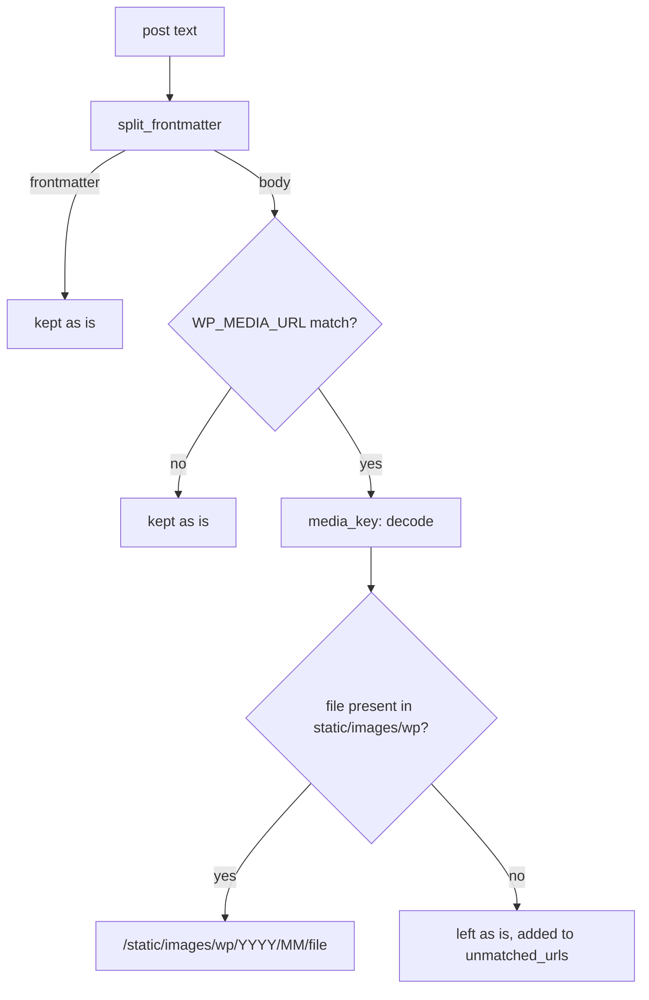

# `wp_media.py` — Bringing WordPress-Era Images Home

## What this module is for

Before this site, salas.com ran on WordPress.com. Posts imported from that
era embed images hosted in WordPress's uploads folder, usually through
WordPress's `i0.wp.com` image proxy:

```

```

Those originals are gone, and the URLs now return 404. The WordPress media
export (a tar of `YYYY/MM/<file>` paths) still holds copies of many of
them. This module does two separate jobs, run at separate times (F49):

1. **`extract_media`** copies the tar into the repo's `static/images/wp/`.
   The files are committed and deployed like any other static asset.
2. **`rewrite_wp_media`** points each matching URL in a post body at the
   local copy, `/static/images/wp/2014/08/f41d7-1407946425174.jpg`.

Keeping them apart was what made the production rollout safe. The images
were deployed and checked first, and only then were posts rewritten to
point at them. On production it repaired 72 links in 57 posts.

## Recognising a WordPress image URL

One regular expression does the recognising:

```python
WP_MEDIA_URL = re.compile(
    rf"https?://(?:i\d\.wp\.com/)?(?:www\.)?salas\.com/wp-content/uploads/"
    rf"(\d{{4}}/\d{{2}}/{URL_CHARS}+)(?:\?[^\s\"'()<>\[\]#]*)?"
)
```

Some details that matter:

- **Only salas.com's own uploads match.** The scan also found Squarespace-era
  S3 paths and third-party sites that happen to use `wp-content/uploads`,
  such as `applegazette.com`. Rewriting those would point at files this
  site never had, so they're out of scope by construction, not by a later
  filter.
- **The proxy prefix and its query string are optional.** Both
  `i0.wp.com/salas.com/...?resize=462%2C278&ssl=1` and a bare
  `salas.com/...` link resolve to the same file, and the query is dropped
  in the rewrite.
- **`URL_CHARS` stops at quotes, parentheses, brackets and whitespace.**
  That lets one pattern work inside Markdown ``, `[](...)`
  link-wrapped thumbnails, and raw ``.

## Matching a URL to a file: undoing double encoding

The capture group gives `2011/03/screen%2520shot.png`. That's a space
encoded twice (`%20`, then its `%` encoded as `%25`), which WordPress
produced for some filenames. `media_key` decodes until the string stops
changing:

```python
key = encoded_path
while "%" in key and urllib.parse.unquote(key) != key:
    key = urllib.parse.unquote(key)
```

The result is compared against the set of files actually present.
`available_media(media_dir)` builds that set from `static/images/wp/`, not
from the tar. So on production, where the tar isn't present, the rewrite
checks what was really deployed. When writing the new link,
`urllib.parse.quote` re-encodes the name once, as a URL should be.

## Rewriting a post without touching anything else

```python
frontmatter, body = split_frontmatter(text)
...
new_body = WP_MEDIA_URL.sub(replace, body)
result.text = frontmatter + new_body
```

- **Frontmatter is split off and never rewritten.** Some posts carry a
  truncated image URL in their `subtitle:`, and changing metadata was out
  of scope.
- **`re.sub` with a callback** keeps everything outside a match
  byte-for-byte. The callback either returns the local path or returns the
  original match unchanged, recording it in `unmatched_urls`.
- **Running it twice is a no-op.** A rewritten URL no longer matches the
  pattern, a property the tests pin down.



## Extracting the tar defensively

`extract_media` doesn't call `tarfile.extractall`. It walks the members
itself and **raises on anything that isn't a plain file at a
`YYYY/MM/<name>` path**:

```python
if not member.isfile() or not MEDIA_KEY.match(member.name):
    raise ValueError(f"unexpected tar member {member.name!r}")
```

That blocks the classic *tar-slip* attack, where a member named
`../../etc/x` or a symlink writes outside the target directory. It also
rejects anything that doesn't look like this particular export. An
archive that surprises the code fails loudly instead of half-extracting.

## Reporting what couldn't be fixed

`rewrite_media_content` walks the content directories, prints one line per
changed file, and returns every unmatched URL. With `--report`, the CLI
HEAD-checks each one with `url_status`, which turns HTTP errors into their
status code rather than raising. The four unmatched URLs on production were
2023 screenshots missing from the export, and all returned 404.

## Observations for future improvement

- **The tar is fully extracted, including files no post references.** All
  110 files (30 MB) went into the repo and the Docker image, though only
  about 74 are linked. Extracting only referenced keys would shrink both,
  at the cost of scanning production content before extracting.
- **`url_status` uses HEAD**, which some servers reject or answer
  differently from GET. A fallback to a ranged GET would make the report
  more trustworthy.
- **The salas.com-only pattern is hard-coded.** That's right for this
  one-time migration. If another legacy host turns up, a parameterized
  host list would be better than a second regex.
