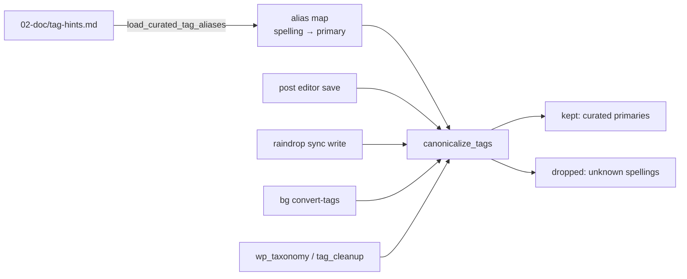

# `tag_vocabulary.py` — One Rule for Every Tag

## What this module is for

Before F55, tags reached the site by four routes, each with its own idea of
what a valid tag was:

- the post editor accepted anything typed
- raindrop sync copied whatever Raindrop.io had
- the generator displayed every tag it found
- the F46/F50 automation added curated tags and grew the list itself

F55 replaced all of that with a **closed list of 16 tags** in
`02-doc/tag-hints.md`, each with its aliases. This module is the single
function that applies that list. Every route now calls it, so they can't
drift apart again.



The generator is the one reader that doesn't convert. It only filters,
keeping primaries, because by then the files should already hold nothing
else.

## The alias map as a lookup table

The map comes from `utils.parse_curated_tag_aliases`. Every primary maps to
itself, and every alias maps to its primary:

```python
{"robotics": "robotics", "robot": "robotics", "lidar": "robotics", ...}
```

That makes conversion a **single dictionary lookup per tag**, O(1) on
average, rather than a scan of 16 lines of aliases. The installed list has
445 keys (16 primaries plus 429 aliases), so the whole map is tiny.

A test checks the one property the lookup can't: that no alias appears
under two primaries. A plain `dict` built line by line would silently let
the later line win.

## `canonicalize_tags`: keep, convert, drop

```python
def canonicalize_tags(tags, alias_map):
    result = CanonicalTags()
    for tag in tags:
        primary = alias_map.get(tag_key(tag))
        if primary is None:
            result.dropped.append(str(tag))
        elif primary not in result.kept:
            result.kept.append(primary)
    return result
```

Three choices are worth naming:

- **It reports what it drops.** Callers decide what a drop means. The
  editor turns it into a 400 error, raindrop sync discards it, and the
  conversion command counts it. A function that dropped silently would
  force the editor to re-derive the same information.
- **Order is first-seen, and duplicates collapse.** `chatgpt, robot, ai`
  becomes `ai, robotics`. The membership test on a list is linear, but a
  post carries a handful of tags, so a set alongside it would be noise.
- **The dropped list keeps the original spelling**, so an error message
  says `Banana Split`, which is what the author typed, not `banana-split`.

## `tag_key`: comparing spellings, not strings

```python
def tag_key(tag):
    return re.sub(r"\s+", "-", str(tag).strip().lower())
```

Raindrop.io and hand typing both produce variants like `ChatGPT` or
`Machine Learning`. Folding case and turning inner whitespace into hyphens
lets one alias entry (`machine-learning`) cover them all. `str(tag)` also
handles YAML's habit of parsing a tag like `1221` as an integer. Such a tag
is never in the map, so it lands in `dropped` like any other junk.

## `TAG_HINTS_FILE`: locating the list

```python
TAG_HINTS_FILE = Path(__file__).parents[2] / "02-doc" / "tag-hints.md"
```

The path is relative to the package, not the working directory. That works
because `uv sync` installs the project in editable mode, so the source tree
(and `02-doc/`) sits next to it, both locally and in `/app` on production.
The server is the exception: it builds the same path from
`config["root_dir"]`, which lets its tests point it at a temporary list.

## Observations for future improvement

- **The list is parsed on every call site's load.** The generator and
  raindrop sync load it once per run, and the editor once per save. That's
  cheap at this size, but a cached loader would make the "one list"
  property explicit in code rather than by convention.
- **Two ways to find the file.** `TAG_HINTS_FILE` and the server's
  `curated_tag_hints_path()` should agree in production. Routing the server
  through the constant, with tests patching it, would remove the chance of
  them diverging.
- **No validation on load.** A malformed `tag-hints.md`, such as an alias
  listed twice, is caught only by a test against the project's own file.
  Checking that at load time would protect a hand edit made on production.
