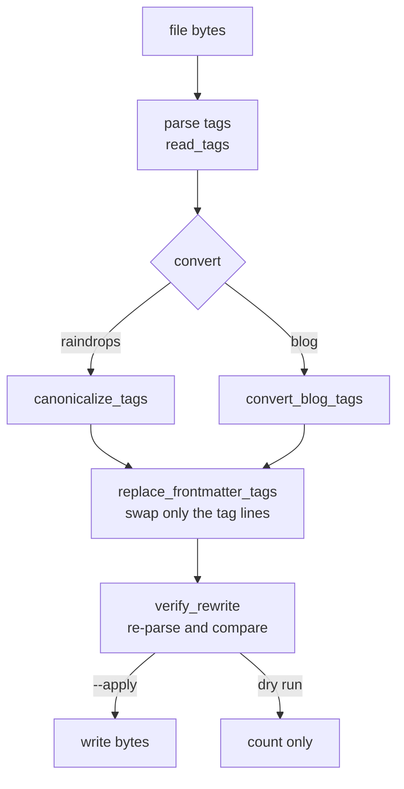

# `tag_conversion.py` — Rewriting 4,000 Files' Tags Without Touching Anything Else

## What this module is for

Closing the tag list (F55) only governs tags written *from now on*. The
existing content still carries hundreds of retired tags: about 1,550
raindrops and 2,834 blog posts on production. This module converts them
**in place**, and supplies the tools for the judgment pass that follows.

It exists separately from `tag_cleanup.py` for one reason: **how it
writes**. F46's `apply_tag_proposal` re-serializes the whole frontmatter
with `frontmatter.dumps()`. That reorders keys, changes quoting and flattens
CRLF line endings, so it has to refuse CRLF files. Over thousands of files
that would make the GitHub backup diff unreadable. This module edits only
the tag lines.



## A line-level edit, not a re-serialization

The frontmatter is treated as lines, not as YAML to rebuild. The `tags:`
entry is the key line plus the list lines under it:

```python
for start in range(1, len(lines)):
    line = lines[start]
    if line.rstrip("\r\n") == "---":
        break
    if not line.startswith("tags:"):
        continue
    end = start + 1
    while end < len(lines) and is_continuation(lines[end]):
        end += 1
    eol = line[len(line.rstrip("\r\n")) :] or "\n"
    return "".join(lines[:start]) + render_tags(tags, eol) + "".join(lines[end:])
```

- **`splitlines(keepends=True)`** keeps each line's own ending, and the new
  entry reuses the ending of the old `tags:` line. A CRLF file stays CRLF.
- **Continuation lines** are those starting with a space, a tab or `-`.
  That covers both shapes found in the archive: the block list (`tags:`
  then `- ai`) and the one-line flow list (`tags: []`).
- **The closing fence is explicitly excluded.** `---` starts with `-`, so
  without that check the fence would be swallowed as a list item and the
  body would join the frontmatter.
- **A missing `tags:` key raises** rather than inserting one. The caller
  never asks for it, since a file without the key has no tags to convert.

This is the same technique as F51's `remove_frontmatter_key`, extended from
deleting a line to replacing a block.

## Trust, but verify

A text edit could still go wrong in a way the code didn't foresee, such as
an odd YAML shape. So every rewrite is checked by **parsing both versions
and comparing**:

```python
if after.content != before.content:
    raise ValueError("body changed")
if read_tags(after) != tags:
    raise ValueError(f"tags did not persist: {after.metadata.get('tags')!r}")
if others_after != others_before:
    raise ValueError("other frontmatter changed")
```

This runs in the dry run too, so a problem surfaces before anything is
written. `convert_directory` wraps every `ValueError` with the file's name.
Like the rest of the project, it **stops at the first bad file** rather than
skipping it, so nothing is half-converted without anyone noticing.

## The blog rule: generic tags as markers

Raindrops go straight through `canonicalize_tags`. Blog posts have one
twist. About a thousand posts carry only the generic `technology` or
`personal`, which the 16-tag list split into `internet`/`computing` and
`life`/`places`. Neither can be decided mechanically.

```python
canonical = canonicalize_tags(tags, alias_map)
if canonical.kept:
    return canonical
generics = [tag for tag in canonical.dropped if tag in GENERIC_BLOG_TAGS]
dropped = [tag for tag in canonical.dropped if tag not in GENERIC_BLOG_TAGS]
return CanonicalTags(kept=list(dict.fromkeys(generics)), dropped=dropped)
```

- A post with a real topic loses its generic tag, which adds nothing.
- A post with no other curated tag **keeps** its generic tag as a marker
  for the judgment pass.

Running the conversion twice changes nothing on the second run. That
*idempotence* matters on production, where a run might be interrupted.

## The judgment pass

`select_generic_posts` finds a batch of posts still carrying a marker, and
the CLI writes their title and excerpt summaries for review. It tracks its
own progress: once a decision replaces a post's marker, the post stops
matching, so no progress file is needed. This is the same design as F46's
selection.

`apply_tag_decisions` then writes the reviewed choices. It works in two
passes:

1. Every decision is canonicalized, and **any unknown tag aborts the whole
   batch** before a single file is written.
2. Only then is each post rewritten, with the same line-level edit and
   verification as above.

A typo in decision 49 of 50 therefore leaves all 50 posts untouched, rather
than 48 applied and the batch in an unknown state.

## Observations for future improvement

- **The module is one-shot.** Once production is converted and the
  judgment passes are done, `convert_blog_tags` and the generic-pass
  helpers have no further use. They can be deleted, along with their CLI
  commands, keeping `replace_frontmatter_tags` if anything else needs it.
- **Two frontmatter writers now coexist.** `tag_cleanup.apply_tag_proposal`
  still re-serializes. Moving it onto `replace_frontmatter_tags` would
  remove its CRLF refusal and make every tag write diff-clean.
- **Continuation detection is heuristic.** A frontmatter key starting with
  `-`, or a multi-line string value right after `tags:`, would confuse it.
  Neither exists in the archive, and the verification step would catch it,
  but a YAML-aware span finder would make the guarantee structural.
