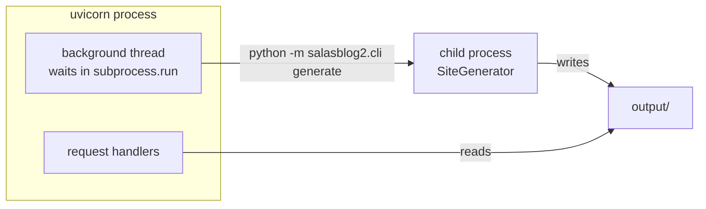

# `site_jobs.py` — Rendering the Site Without Stalling the Server

## What this module is for

The live site was "slow sometimes". Measured on production, the home page
answered in 0.07–0.10 s when quiet, but during an admin Regenerate most
requests took 0.5–2 s and a few took **19, 24 and 33 s**.

The cause was not the page itself, which is a static file. It was what
shared the process with it. Every page is served by one uvicorn process on
one shared CPU, and that same process rendered the site in a background
thread. Python's GIL lets only one thread run Python at a time, and
rendering 4,400 pages is nearly all Python. While the renderer held the
GIL, the event loop got only scraps.

This module moves the rendering into a **child process** with its own
interpreter and its own GIL.



## `run_generation`: one function, three commands

```python
def run_generation(args: list[str]) -> None:
    command = generation_command(args)
    with GENERATION_LOCK:
        logger.info(f"Generation START: bg {' '.join(args)}")
        result = subprocess.run(command, check=False, capture_output=True, text=True)
    if result.returncode != 0:
        raise RuntimeError(...)
```

- **The child is the `bg` CLI.** `generation_command` builds
  `[sys.executable, "-m", "salasblog2.cli", *args]`. `sys.executable` means
  the child uses the same virtualenv as the server without going through
  `uv run`. The three commands are `generate`, `regen-post FILE TYPE` and
  `regen-deleted FILE TYPE`, so the CLI and the server share one code path
  into `SiteGenerator`.
- **The calling thread still waits.** Callers already ran generation in a
  `BackgroundTasks` task or the thread pool, and they still do. What
  changed is what the thread does while it waits: it sleeps in
  `subprocess.run`, which releases the GIL.
- **The child inherits the server's environment and working directory**,
  so it finds `/data/content`, the theme and `output/` exactly as the
  server would.

## One generation at a time

`GENERATION_LOCK` is a module-level `threading.Lock`. Two children writing
`output/` at once, for example a post save landing during a full
Regenerate, would race on the same listing and search files. With the lock,
the second caller simply waits for the first child to exit. A test starts
two children that each write a start and an end mark to one file, and
checks that the marks never interleave.

The lock lives in the server process, so it doesn't cover `startup.sh`'s
own `bg generate &` at boot. That was true before this module too.

## Failure is loud

A child that exits non-zero raises `RuntimeError` carrying the tail of its
stderr (the last 2,000 characters, which is where a Python traceback
ends). The callers already log generation exceptions, so a broken template
now shows up in `fly logs` with its traceback instead of a bare exit code.

## Observations for future improvement

- **Process start-up costs about a second.** Interpreter start-up plus
  imports is negligible next to a full generation, but it is the reason
  `render_post_page_now` (one page, awaited before the editor's redirect)
  still renders in process.
- **A raindrop sync with several new drops runs one child per drop**, and
  each child reloads all content. It is rare and off the request path now,
  but a `regen-post` that took several filenames would do it in one pass.
- **The child's stdout is discarded.** `SiteGenerator` reports progress with
  `print`, which nobody needs on success. If that progress ever matters,
  the place to put it is the logger, not the pipe.
- **The lock is per process.** It would not protect `output/` if the app
  ever ran more than one server process or machine; `fly.toml` pins it to
  one.
